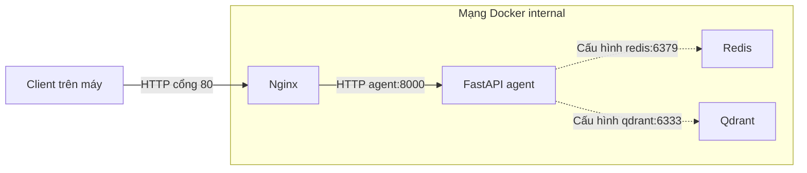

# Day 14 — Mission Answers

## Part 1 — Localhost vs Production

### Exercise 1.1 — Các vấn đề trong bản develop

1. [Dòng 17–18](01-localhost-vs-production/develop/app.py#L17-L18) đặt API key mẫu và thông tin kết nối trực tiếp trong mã. Nếu thay bằng thông tin thật, người có quyền đọc repo hoặc lịch sử Git sẽ thấy chúng.
2. [Dòng 33–38](01-localhost-vs-production/develop/app.py#L33-L38) dùng `print()` để ghi cả câu hỏi, câu trả lời và API key mẫu. Cách này có thể làm lộ dữ liệu nhạy cảm và khiến việc lọc log theo sự kiện khó hơn.
3. [Dòng 42–43](01-localhost-vs-production/develop/app.py#L42-L43) ghi nhận bản develop thiếu endpoint health check. Hệ thống giám sát vì thế thiếu một điểm kiểm tra riêng để xác định tiến trình còn phục vụ được hay không.
4. [Dòng 51](01-localhost-vs-production/develop/app.py#L51) chỉ lắng nghe trên `localhost`. Trong container, cấu hình loopback này khiến các kết nối đi từ bên ngoài container không tới được ứng dụng.
5. [Dòng 52](01-localhost-vs-production/develop/app.py#L52) cố định cổng `8000`. Nếu nền tảng cấp cổng khác qua biến `PORT`, app vẫn nghe cổng cũ và có thể không nhận được lưu lượng.
6. [Dòng 53](01-localhost-vs-production/develop/app.py#L53) luôn bật `reload`. Chế độ này thuận tiện khi sửa mã nhưng có thể khởi động lại server khi file thay đổi trong lúc đang phục vụ.

### Exercise 1.2 — Chạy và gọi bản develop

Em chạy mã mẫu trong container Python 3.11 trên Docker Desktop qua WSL2. Cổng 8000 trên máy đã được dùng, nên em ánh xạ cổng 8011 của máy tới cổng 8000 trong container.

```bash
curl -i -X POST "http://127.0.0.1:8011/ask?question=Hello"
```

```http
HTTP/1.1 200 OK
date: Thu, 26 Nov 2026 10:56:49 GMT
server: uvicorn
content-length: 103
content-type: application/json

{"answer":"Tôi là AI agent được deploy lên cloud. Câu hỏi của bạn đã được nhận."}
```

Kết quả xác nhận endpoint nhận câu hỏi từ query và trả câu trả lời của mock LLM.

### Exercise 1.3 — So sánh hai phiên bản

| Hạng mục | Develop | Production | Vì sao quan trọng |
| --- | --- | --- | --- |
| Cấu hình | Cố định host, cổng và chế độ reload tại [`develop/app.py` dòng 51–53](01-localhost-vs-production/develop/app.py#L51-L53). | Đọc `HOST`, `PORT` và `DEBUG` từ môi trường tại [`production/config.py` dòng 17–19](01-localhost-vs-production/production/config.py#L17-L19). | Cùng một bản mã có thể chạy với cấu hình khác nhau ở local và trên cloud. |
| Health check | Thiếu endpoint riêng cho liveness và readiness. | [`/health`](01-localhost-vs-production/production/app.py#L135) báo trạng thái và uptime. [`/ready`](01-localhost-vs-production/production/app.py#L152) dựa vào cờ sẵn sàng và trả 503 khi cờ tắt. | Hệ thống có thể kiểm tra tiến trình còn sống và quyết định khi nào nên chuyển request vào. |
| Logging | Dùng `print()`, in cả câu hỏi và key mẫu. | Dùng `logging` và ghi các trường như loại sự kiện, độ dài câu hỏi và độ dài câu trả lời tại [`production/app.py` dòng 110–122](01-localhost-vs-production/production/app.py#L110-L122). | Các trường nhất quán giúp tìm sự kiện nhanh và giảm dữ liệu nhạy cảm trong log. |
| Shutdown | Thiếu bước dọn dẹp riêng ở cấp ứng dụng. | Dùng FastAPI `lifespan` để đặt lại cờ readiness và ghi log khi tắt tại [`production/app.py` dòng 40–64](01-localhost-vs-production/production/app.py#L40-L64). | Có chỗ dọn tài nguyên khi server dừng. Tắt có kiểm soát giúp request đang xử lý có cơ hội hoàn tất. |

## Part 2 — Docker

### Exercise 2.1 — Dockerfile bản develop

1. **Base image** là `python:3.11`. Dòng `FROM` chọn image có sẵn hệ điều hành nền và Python 3.11 để làm nền cho các bước tiếp theo.
2. **Working directory** là `/app` trong image. `WORKDIR /app` đặt thư mục làm việc cho các lệnh tiếp theo và cho tiến trình khi container chạy.
3. **Chép requirements trước mã nguồn** giúp Docker dùng lại layer cài thư viện khi chỉ sửa mã Python. Khi `requirements.txt` thay đổi, bước cài thư viện mới cần chạy lại.
4. **`CMD` và `ENTRYPOINT`** có vai trò khác nhau. `CMD` đặt lệnh mặc định hoặc tham số mặc định cho `ENTRYPOINT`. Khi có `ENTRYPOINT` dạng exec, đối số sau tên image trong `docker run` thay cho `CMD` và được truyền vào chương trình đó. Dockerfile này dùng `CMD ["python", "app.py"]` làm lệnh mặc định. [Dockerfile develop](02-docker/develop/Dockerfile)

### Exercise 2.2 — Chạy và gọi container develop

Em chạy image `my-agent:develop` và ánh xạ cổng 8012 trên máy tới cổng 8000 trong container. Em gọi API từ terminal WSL trong VS Code.

Lệnh build và chạy từ gốc repo:

```bash
docker build -f 02-docker/develop/Dockerfile -t my-agent:develop .
docker run --rm -it -p 127.0.0.1:8012:8000 my-agent:develop
```

Lệnh kiểm tra từ terminal thứ hai:

```bash
curl -i -X POST "http://127.0.0.1:8012/ask?question=Hello"
```

```http
HTTP/1.1 200 OK
date: Thu, 26 Nov 2026 11:23:48 GMT
server: uvicorn
content-length: 103
content-type: application/json

{"answer":"Tôi là AI agent được deploy lên cloud. Câu hỏi của bạn đã được nhận."}
```

### Exercise 2.3 — Multi-stage build và dung lượng image

Em đo cả hai image bằng `docker images my-agent` sau khi build:

| Image | DISK USAGE | CONTENT SIZE |
| --- | ---: | ---: |
| `my-agent:develop` | 1,67 GB | 426 MB |
| `my-agent:advanced` | 240 MB | 57,4 MB |

So theo cùng cột `DISK USAGE`, image advanced giảm khoảng **85,6%** so với develop. Quy đổi 1,67 GB thành khoảng 1.670 MB, phép tính là `(1670 - 240) / 1670 × 100`. Theo cột `CONTENT SIZE`, mức giảm là khoảng **86,5%**.

Trong [Dockerfile production](02-docker/production/Dockerfile), stage `builder` dùng `python:3.11-slim` để cài công cụ build và các gói Python. Stage `runtime` cũng dùng base slim, chép các gói đã cài và mã cần chạy rồi chuyển sang user `appuser`. Image cuối nhẹ hơn vì base slim nhỏ hơn base `python:3.11` của bản develop và các công cụ build như `gcc` được giữ ở stage builder.

### Exercise 2.4 — Docker Compose và Nginx

Sơ đồ theo cấu hình của stack:



Compose khai báo bốn service chung mạng `internal`. Nginx nhận HTTP ở cổng 80 và chuyển request đến `agent:8000`. Compose đợi Redis và Qdrant healthy trước khi khởi động agent, đồng thời truyền URL nội bộ của hai dịch vụ vào agent. Hai đường nét đứt thể hiện cấu hình phụ thuộc. Các request thử dưới đây đi qua Nginx, còn `/ask` gọi mock LLM. [Docker Compose](02-docker/production/docker-compose.yml) · [Cấu hình Nginx](02-docker/production/nginx/nginx.conf) · [Mã agent](02-docker/production/main.py)

Em gọi hai endpoint qua Nginx:

```bash
curl -i http://127.0.0.1/health

curl -i -X POST http://127.0.0.1/ask \
  -H 'Content-Type: application/json' \
  -d '{"question":"Explain microservices"}'
```

Kết quả `GET /health`:

```http
HTTP/1.1 200 OK
Server: nginx
Content-Type: application/json

{"status":"ok","uptime_seconds":119.7,"version":"2.0.0","timestamp":"2026-11-26T11:29:08.794337"}
```

Kết quả `POST /ask`:

```http
HTTP/1.1 200 OK
Server: nginx
Content-Type: application/json

{"answer":"Đây là câu trả lời từ AI agent (mock). Trong production, đây sẽ là response từ OpenAI/Anthropic."}
```

## AI log

- **CP1** — Em hỏi AI về yêu cầu K5, cách xử lý lỗi WSL và cách chạy app mẫu khi cổng 8000 đang bận. AI gợi ý chạy qua cổng 8011 và hỗ trợ soạn phần phân tích từ mã nguồn. Em trực tiếp chạy container và `curl`, kiểm tra `200 OK` cùng trường `answer`, sau đó rà soát phần phân tích và bảng so sánh, rồi yêu cầu chỉnh cách xưng hô trong báo cáo.
- **CP2, Exercise 2.1–2.2** — Em mở Dockerfile develop và hỏi AI các dòng cần đối chiếu với bốn câu của đề. AI giải thích các lệnh và hỗ trợ diễn đạt. Em trực tiếp chạy container và gọi `/ask` qua cổng 8012 trong WSL, rồi lưu phản hồi `200 OK`.
- **CP2, Exercise 2.3** — Em chạy `docker images my-agent` để lấy số đo của hai image. AI giúp phân biệt hai cột dung lượng, tính tỷ lệ giảm từ output em cung cấp và giải thích hai stage dựa trên Dockerfile.
- **CP2, Exercise 2.4** — Em trực tiếp gọi `GET /health` và `POST /ask`, kiểm tra cả hai phản hồi có `200 OK` và header `Server: nginx`. AI đối chiếu cấu hình Compose và Nginx để vẽ sơ đồ và trình bày bằng chứng từ terminal của em.
