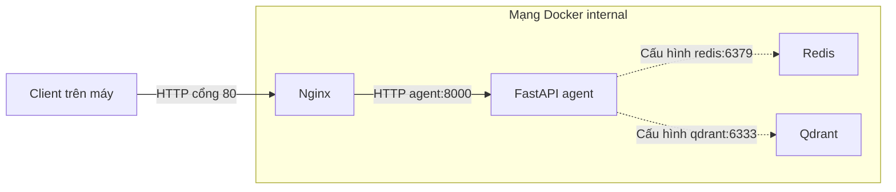

# Day 14 — Mission Answers

## Part 1 — Localhost vs Production

### Exercise 1.1 — Các vấn đề trong bản develop

1. [Dòng 17–18](01-localhost-vs-production/develop/app.py#L17-L18) đặt API key mẫu và thông tin kết nối trực tiếp trong mã. Nếu thay bằng thông tin thật, người có quyền đọc repo hoặc lịch sử Git sẽ thấy chúng.
2. [Dòng 33–38](01-localhost-vs-production/develop/app.py#L33-L38) dùng `print()` để ghi cả câu hỏi, câu trả lời và API key mẫu. Cách này có thể làm lộ dữ liệu nhạy cảm và khiến việc lọc log theo sự kiện khó hơn.
3. [Dòng 42–43](01-localhost-vs-production/develop/app.py#L42-L43) ghi nhận bản develop thiếu endpoint health check. Hệ thống giám sát vì thế thiếu một điểm kiểm tra riêng để xác định tiến trình còn phục vụ được hay không.
4. [Dòng 51](01-localhost-vs-production/develop/app.py#L51) chỉ lắng nghe trên `localhost`. Trong container, cấu hình loopback này khiến các kết nối đi từ bên ngoài container không tới được ứng dụng.
5. [Dòng 52](01-localhost-vs-production/develop/app.py#L52) cố định cổng `8000`. Nếu nền tảng cấp cổng khác qua biến `PORT`, app vẫn nghe cổng cũ và có thể không nhận được lưu lượng.
6. [Dòng 53](01-localhost-vs-production/develop/app.py#L53) luôn bật `reload`. Chế độ này thuận tiện khi sửa mã nhưng có thể khởi động lại server khi file thay đổi trong lúc đang phục vụ.

### Exercise 1.2 — Chạy và gọi bản develop

Em chạy mã mẫu trong container Python 3.11 trên Docker Desktop qua WSL2. Cổng 8000 trên máy đã được dùng, nên em ánh xạ cổng 8011 của máy tới cổng 8000 trong container.

```bash
curl -i -X POST "http://127.0.0.1:8011/ask?question=Hello"
```

```http
HTTP/1.1 200 OK
date: Thu, 26 Nov 2026 10:56:49 GMT
server: uvicorn
content-length: 103
content-type: application/json

{"answer":"Tôi là AI agent được deploy lên cloud. Câu hỏi của bạn đã được nhận."}
```

Kết quả xác nhận endpoint nhận câu hỏi từ query và trả câu trả lời của mock LLM.

### Exercise 1.3 — So sánh hai phiên bản

| Hạng mục | Develop | Production | Vì sao quan trọng |
| --- | --- | --- | --- |
| Cấu hình | Cố định host, cổng và chế độ reload tại [`develop/app.py` dòng 51–53](01-localhost-vs-production/develop/app.py#L51-L53). | Đọc `HOST`, `PORT` và `DEBUG` từ môi trường tại [`production/config.py` dòng 17–19](01-localhost-vs-production/production/config.py#L17-L19). | Cùng một bản mã có thể chạy với cấu hình khác nhau ở local và trên cloud. |
| Health check | Thiếu endpoint riêng cho liveness và readiness. | [`/health`](01-localhost-vs-production/production/app.py#L135) báo trạng thái và uptime. [`/ready`](01-localhost-vs-production/production/app.py#L152) dựa vào cờ sẵn sàng và trả 503 khi cờ tắt. | Hệ thống có thể kiểm tra tiến trình còn sống và quyết định khi nào nên chuyển request vào. |
| Logging | Dùng `print()`, in cả câu hỏi và key mẫu. | Dùng `logging` và ghi các trường như loại sự kiện, độ dài câu hỏi và độ dài câu trả lời tại [`production/app.py` dòng 110–122](01-localhost-vs-production/production/app.py#L110-L122). | Các trường nhất quán giúp tìm sự kiện nhanh và giảm dữ liệu nhạy cảm trong log. |
| Shutdown | Thiếu bước dọn dẹp riêng ở cấp ứng dụng. | Dùng FastAPI `lifespan` để đặt lại cờ readiness và ghi log khi tắt tại [`production/app.py` dòng 40–64](01-localhost-vs-production/production/app.py#L40-L64). | Có chỗ dọn tài nguyên khi server dừng. Tắt có kiểm soát giúp request đang xử lý có cơ hội hoàn tất. |

## Part 2 — Docker

### Exercise 2.1 — Dockerfile bản develop

1. **Base image** là `python:3.11`. Dòng `FROM` chọn image có sẵn hệ điều hành nền và Python 3.11 để làm nền cho các bước tiếp theo.
2. **Working directory** là `/app` trong image. `WORKDIR /app` đặt thư mục làm việc cho các lệnh tiếp theo và cho tiến trình khi container chạy.
3. **Chép requirements trước mã nguồn** giúp Docker dùng lại layer cài thư viện khi chỉ sửa mã Python. Khi `requirements.txt` thay đổi, bước cài thư viện mới cần chạy lại.
4. **`CMD` và `ENTRYPOINT`** có vai trò khác nhau. `CMD` đặt lệnh mặc định hoặc tham số mặc định cho `ENTRYPOINT`. Khi có `ENTRYPOINT` dạng exec, đối số sau tên image trong `docker run` thay cho `CMD` và được truyền vào chương trình đó. Dockerfile này dùng `CMD ["python", "app.py"]` làm lệnh mặc định. [Dockerfile develop](02-docker/develop/Dockerfile)

### Exercise 2.2 — Chạy và gọi container develop

Em chạy image `my-agent:develop` và ánh xạ cổng 8012 trên máy tới cổng 8000 trong container. Em gọi API từ terminal WSL trong VS Code.

Lệnh build và chạy từ gốc repo:

```bash
docker build -f 02-docker/develop/Dockerfile -t my-agent:develop .
docker run --rm -it -p 127.0.0.1:8012:8000 my-agent:develop
```

Lệnh kiểm tra từ terminal thứ hai:

```bash
curl -i -X POST "http://127.0.0.1:8012/ask?question=Hello"
```

```http
HTTP/1.1 200 OK
date: Thu, 26 Nov 2026 11:23:48 GMT
server: uvicorn
content-length: 103
content-type: application/json

{"answer":"Tôi là AI agent được deploy lên cloud. Câu hỏi của bạn đã được nhận."}
```

### Exercise 2.3 — Multi-stage build và dung lượng image

Em đo cả hai image bằng `docker images my-agent` sau khi build:

| Image | DISK USAGE | CONTENT SIZE |
| --- | ---: | ---: |
| `my-agent:develop` | 1,67 GB | 426 MB |
| `my-agent:advanced` | 240 MB | 57,4 MB |

So theo cùng cột `DISK USAGE`, image advanced giảm khoảng **85,6%** so với develop. Quy đổi 1,67 GB thành khoảng 1.670 MB, phép tính là `(1670 - 240) / 1670 × 100`. Theo cột `CONTENT SIZE`, mức giảm là khoảng **86,5%**.

Trong [Dockerfile production](02-docker/production/Dockerfile), stage `builder` dùng `python:3.11-slim` để cài công cụ build và các gói Python. Stage `runtime` cũng dùng base slim, chép các gói đã cài và mã cần chạy rồi chuyển sang user `appuser`. Image cuối nhẹ hơn vì base slim nhỏ hơn base `python:3.11` của bản develop và các công cụ build như `gcc` được giữ ở stage builder.

### Exercise 2.4 — Docker Compose và Nginx

Sơ đồ theo cấu hình của stack:



Compose khai báo bốn service chung mạng `internal`. Nginx nhận HTTP ở cổng 80 và chuyển request đến `agent:8000`. Compose đợi Redis và Qdrant healthy trước khi khởi động agent, đồng thời truyền URL nội bộ của hai dịch vụ vào agent. Hai đường nét đứt thể hiện cấu hình phụ thuộc. Các request thử dưới đây đi qua Nginx, còn `/ask` gọi mock LLM. [Docker Compose](02-docker/production/docker-compose.yml) · [Cấu hình Nginx](02-docker/production/nginx/nginx.conf) · [Mã agent](02-docker/production/main.py)

Em gọi hai endpoint qua Nginx:

```bash
curl -i http://127.0.0.1/health

curl -i -X POST http://127.0.0.1/ask \
  -H 'Content-Type: application/json' \
  -d '{"question":"Explain microservices"}'
```

Kết quả `GET /health`:

```http
HTTP/1.1 200 OK
Server: nginx
Content-Type: application/json

{"status":"ok","uptime_seconds":119.7,"version":"2.0.0","timestamp":"2026-11-26T11:29:08.794337"}
```

Kết quả `POST /ask`:

```http
HTTP/1.1 200 OK
Server: nginx
Content-Type: application/json

{"answer":"Đây là câu trả lời từ AI agent (mock). Trong production, đây sẽ là response từ OpenAI/Anthropic."}
```

## Part 3 — Cloud Deployment

### Exercise 3.1 — Railway

Em deploy agent Part 6 từ `06-lab-complete/` bằng Dockerfile đã qua CP5. Trên URL public, `/health` và `/ready` trả `200`. `POST /ask` trả `401` khi thiếu key và `200` khi dùng key em đặt trên Railway. [URL Railway](https://day14-agent-production-d8849856.up.railway.app) · [Ảnh kiểm tra](screenshots/test.png) · [DEPLOYMENT.md](DEPLOYMENT.md)

### Exercise 3.2 — So sánh cấu hình Railway và Render

| Hạng mục | Railway | Render |
| --- | --- | --- |
| Phạm vi cấu hình | [`railway.toml` của Part 6](06-lab-complete/railway.toml) mô tả build bằng Dockerfile và healthcheck `/health` của agent. Với service mới, em sẽ đặt các thông số tương ứng trong dashboard vì Railway đã ngừng cho service mới bật Config as Code. | [`render.yaml` mẫu](03-cloud-deployment/render/render.yaml) khai báo web service và dịch vụ cache trong cùng Blueprint. |
| Build và start | Railway dùng Dockerfile trong thư mục nguồn đã chọn. Lệnh chạy của image mở agent theo `PORT`. | Mẫu Render dùng runtime Python, khai báo riêng lệnh cài requirements, lệnh chạy Uvicorn theo `PORT` và `healthCheckPath`. |
| Redis và secret | Tạo Redis trong cùng project và truyền `REDIS_URL` vào agent bằng tham chiếu biến. Đặt `AGENT_API_KEY` trong Variables của agent. | Blueprint có thể khai báo tham chiếu dịch vụ cho URL cache. Mẫu dùng `generateValue` cho API key và `sync: false` cho biến cần nhập khi thiết lập. |

[Railway Config as Code](https://docs.railway.com/config-as-code) · [Railway Dockerfiles](https://docs.railway.com/builds/dockerfiles) · [Render Blueprint Reference](https://render.com/docs/blueprint-spec)

### Exercise 3.3 — Pipeline Cloud Run

1. Job `test` trong `cloudbuild.yaml` cài requirements và chạy `pytest tests/`.
2. Job `build` tạo image với hai tag, mã commit và `latest`. Job `push` đẩy cả hai tag lên registry.
3. Job `deploy` đưa image theo mã commit lên Cloud Run tại `asia-southeast1`, đặt biến môi trường và tham chiếu secret từ Secret Manager.
4. `service.yaml` mô tả cấu hình service gồm cổng, tài nguyên, số instance, giới hạn request đồng thời, liveness probe và startup probe. [Cloud Build](03-cloud-deployment/production-cloud-run/cloudbuild.yaml) · [Cloud Run service](03-cloud-deployment/production-cloud-run/service.yaml)

## Part 4 — API Security

### Exercise 4.1 — API key

`verify_api_key` đọc header `X-API-Key` và so sánh với `AGENT_API_KEY`. Thiếu key trả HTTP 401, sai key trả HTTP 403, và đúng key cho phép gọi `POST /ask`. Vì bản mẫu đọc biến khi khởi động, cách đổi key là đặt giá trị mới trong môi trường, khởi động lại service và cập nhật client. [Kiểm tra API key](04-api-gateway/develop/app.py#L29-L54)

Kết quả `curl -i` khi gửi JSON `{"question":"Hello"}` tới bản develop trong container kiểm thử:

```http
HTTP/1.1 401 Unauthorized
content-type: application/json

{"detail":"Missing API key. Include header: X-API-Key: <your-key>"}
```

```http
HTTP/1.1 200 OK
content-type: application/json

{"question":"Hello","answer":"Tôi là AI agent được deploy lên cloud. Câu hỏi của bạn đã được nhận."}
```

```http
HTTP/1.1 403 Forbidden
content-type: application/json

{"detail":"Invalid API key."}
```

### Exercise 4.2 — JWT

Client gửi tài khoản lab tới `POST /auth/token`. Server xác thực thông tin đăng nhập và ký JWT bằng HS256. Token mang tên tài khoản, vai trò và thời hạn 60 phút. Khi client gọi `POST /ask` với `Authorization: Bearer <token>`, server kiểm tra chữ ký và hạn token trước khi lấy thông tin người dùng. [Endpoint đăng nhập](04-api-gateway/production/app.py#L105-L120) · [Tạo và kiểm tra JWT](04-api-gateway/production/auth.py#L35-L66)

Kết quả đăng nhập bằng tài khoản lab `student` đã che token:

```http
HTTP/1.1 200 OK

{"access_token":"[đã che]","token_type":"bearer","expires_in_minutes":60}
```

Lần gọi `POST /ask` đầu tiên với Bearer token trả `HTTP/1.1 200 OK`, body có câu hỏi `Explain JWT`, câu trả lời của mock LLM và `requests_remaining: 9`.

### Exercise 4.3 — Rate limiting

Bản mẫu dùng cửa sổ trượt 60 giây. Mỗi tài khoản có một hàng đợi timestamp trong bộ nhớ. Server loại các timestamp quá hạn rồi đếm số request còn lại. Vai trò `user` có giới hạn 10 request/phút, còn `admin` được chọn bộ giới hạn 100 request/phút sau khi xác thực JWT. Khi chạm giới hạn, server trả `429` cùng header `Retry-After`. [Rate limiter](04-api-gateway/production/rate_limiter.py#L33-L87) · [Chọn giới hạn theo vai trò](04-api-gateway/production/app.py#L125-L145)

Em lấy JWT cho tài khoản mẫu `student` và tự chạy vòng lặp `curl` trong terminal WSL của VS Code. Vòng lặp gửi 11 request `POST /ask` tới cổng 8013 trên máy, với cùng một Bearer token và câu hỏi `Test rate limit`. Đây là output từ terminal của em:

```text
Lượt 1: HTTP/1.1 200 OK
Lượt 2: HTTP/1.1 200 OK
Lượt 3: HTTP/1.1 200 OK
Lượt 4: HTTP/1.1 200 OK
Lượt 5: HTTP/1.1 200 OK
Lượt 6: HTTP/1.1 200 OK
Lượt 7: HTTP/1.1 200 OK
Lượt 8: HTTP/1.1 200 OK
Lượt 9: HTTP/1.1 200 OK
Lượt 10: HTTP/1.1 200 OK
Lượt 11: HTTP/1.1 429 Too Many Requests
```

Lần kiểm thử do AI chạy trước đó cũng nhận `429` ở request `/ask` thứ 11, tính cả lần gọi thành công ở Exercise 4.2. Phản hồi đó có các header và body sau:

```http
HTTP/1.1 429 Too Many Requests
x-ratelimit-limit: 10
x-ratelimit-remaining: 0
retry-after: 59
content-type: application/json

{"detail":{"error":"Rate limit exceeded","limit":10,"window_seconds":60,"retry_after_seconds":59}}
```

### Exercise 4.4 — Cost guard

Bản mẫu kiểm tra chi tiêu trước khi gọi mock LLM, rồi ghi nhận số token và chi phí sau khi gọi. Chi phí được tính riêng cho token đầu vào và đầu ra theo đơn giá trên 1.000 token. Mẫu lưu số liệu trong bộ nhớ, chặn ở mức 1 USD/ngày cho mỗi người dùng bằng HTTP 402 và dùng HTTP 503 khi chạm ngưỡng toàn dịch vụ. Rate limiter giới hạn số lượt gọi, còn cost guard giới hạn tiền vì một lượt gọi có thể dùng nhiều token hơn lượt khác. [Cost guard mẫu](04-api-gateway/production/cost_guard.py#L18-L128)

Với yêu cầu 10 USD/người/tháng của bài, em sẽ dùng khóa Redis theo người dùng và tháng UTC. Trước khi gọi LLM, đọc chi tiêu đã ghi và đối chiếu tổng cộng chi phí ước tính với ngưỡng 10 USD. Thao tác kiểm tra và giữ trước phần ngân sách ước tính cần thực hiện nguyên tử để nhiều request đồng thời dùng cùng ngân sách. Sau khi có kết quả, điều chỉnh theo số token thực tế. Tháng mới bắt đầu bằng khóa mới và có thể đặt TTL để dọn khóa cũ.

## Part 5 — Scaling & Reliability

### Exercise 5.1 — Liveness và readiness

Trong bản develop, `GET /health` báo tiến trình còn phản hồi và trả thông tin như uptime và bộ nhớ. `GET /ready` dùng cờ `_is_ready` để cho biết instance đã sẵn sàng nhận request. Khi cờ tắt, endpoint trả HTTP 503. Việc tách hai endpoint giúp hệ thống tạm ngừng chuyển traffic vào một instance trong khi tiến trình vẫn còn sống. [Bản develop](05-scaling-reliability/develop/app.py#L104-L159)

Trong lần chạy bản develop, `GET /health` trả `200 OK` với `status: ok`. `GET /ready` cũng trả `200 OK`, với body `{"ready":true,"in_flight_requests":1}`. Bộ đếm có tính cả chính request readiness.

### Exercise 5.2 — Graceful shutdown

Bản develop để Uvicorn xử lý SIGTERM với thời gian chờ tối đa 30 giây. Trong vòng đời ứng dụng, bước shutdown đặt `_is_ready` về `False`, chờ nếu còn request được theo dõi và ghi log khi hoàn tất. Phép thử gửi một request chậm của mock LLM rồi gửi SIGTERM trong lúc request đang chạy. [Lifespan](05-scaling-reliability/develop/app.py#L40-L64) · [Cấu hình tín hiệu và Uvicorn](05-scaling-reliability/develop/app.py#L175-L199)

Sau khi gửi SIGTERM, `POST /ask?question=Long%20task` vẫn trả `HTTP/1.1 200 OK`. Server ghi `Graceful shutdown initiated...` rồi `Shutdown complete` và thoát với mã `0`.

### Exercise 5.3 — Chia sẻ session qua Redis

Mỗi instance có bộ nhớ riêng. Nếu instance A giữ lịch sử trong RAM thì instance B sẽ thiếu dữ liệu khi nhận lượt hỏi tiếp theo cùng session. Trong bản production mẫu, các instance dùng chung khóa Redis `session:<session_id>`. Khi ghi session, app dùng `SETEX` với TTL mặc định 3.600 giây và giữ tối đa 20 tin nhắn. Bản mẫu có chế độ dự phòng lưu trong RAM khi không kết nối được Redis lúc khởi động. Chế độ đó chỉ giữ dữ liệu trong từng instance. [Lưu và đọc session](05-scaling-reliability/production/app.py#L32-L91)

### Exercise 5.4 — Chạy ba instance sau Nginx

Client gọi Nginx trên cổng 8080. Nginx chuyển request đến các bản sao `agent:8000` trong mạng Compose. Các agent dùng chung Redis. Trường `served_by` trong body `POST /chat` cho biết instance nào đã xử lý, còn header `X-Served-By` của Nginx cho biết địa chỉ upstream. [Compose](05-scaling-reliability/production/docker-compose.yml) · [Nginx](05-scaling-reliability/production/nginx.conf)

Em chạy các lệnh sau trong `05-scaling-reliability/production/`:

```bash
touch .env.local
docker compose -p k5-day14-scaling up -d --build --scale agent=3 --wait
python3 test_stateless.py
```

Output Compose của em báo cả ba agent, Redis và Nginx đều `Healthy`. Lần kiểm tra bổ sung do AI thực hiện qua Nginx cũng ghi nhận `GET /health` trả `200` với `storage: redis` và `redis_connected: true`, còn `GET /ready` trả `200` với `ready: true`.

### Exercise 5.5 — Kiểm tra session khi đổi instance

`test_stateless.py` gửi năm câu hỏi vào cùng một session, ghi lại `served_by` của từng lượt rồi gọi endpoint history. Năm lượt thành công tạo 10 tin nhắn, gồm năm câu hỏi và năm câu trả lời. Script tự kiểm tra history qua nhiều request. Kiểm tra khi một instance dừng được thực hiện riêng. [Script kiểm tra](05-scaling-reliability/production/test_stateless.py)

Kết quả em ghi lại từ `test_stateless.py`:

```text
Request 1: [instance-3bef8f]
Request 2: [instance-0758cd]
Request 3: [instance-ad50cb]
Request 4: [instance-3bef8f]
Request 5: [instance-0758cd]
Total requests: 5
Instances used: {'instance-0758cd', 'instance-3bef8f', 'instance-ad50cb'}
Total messages: 10
```

Em đối chiếu `served_by` với `Instances used` và thấy cùng một session được xử lý bởi cả ba instance. History có đủ 10 tin nhắn của năm lượt hỏi đáp.

Trong phép thử riêng, AI kiểm tra khóa của session bằng `redis-cli TTL` và nhận `3600` giây. Sau đó AI dừng container của `instance-eb4520`, instance đã xử lý lượt đầu. Gọi lại history của session đó qua Nginx vẫn trả `HTTP/1.1 200 OK` và đủ 10 tin nhắn. Header `X-Served-By` liệt kê hai địa chỉ upstream trong lần gọi này. Kết quả cho thấy instance còn hoạt động vẫn đọc được lịch sử từ Redis. AI đã dừng stack của phép thử bằng `docker compose -p k5-day14-scaling down`.

## Part 6 — Production-ready agent

Agent Part 6 dùng `/health` để báo tiến trình còn sống và `/ready` để kiểm tra Redis. `POST /ask` xác thực `X-API-Key`, giới hạn lượt gọi theo cửa sổ 60 giây trong Redis và kiểm tra ngân sách ngày UTC trước khi gọi mock LLM. Sau khi trả lời, agent ghi chi phí ước tính từ số token và ghi log JSON theo request. Dockerfile dùng hai stage, chạy hai worker Uvicorn với user non-root. Compose chạy agent cùng Redis. Cấu hình Railway dùng Dockerfile và kiểm tra `/health`.

### Kết quả script chấm

Em chạy đầy đủ `python check_production_ready.py` trong WSL với Docker. Đây là phần checklist từ output:

```text
📋 Checklist Deliverable
    ✅ Dockerfile (multi-stage, < 500 MB)
    ✅ docker-compose.yml (agent + redis)
    ✅ .dockerignore
    ✅ Health check endpoint (GET /health)
    ✅ Readiness endpoint (GET /ready)
    ✅ API Key authentication
    ✅ Rate limiting
    ✅ Cost guard
    ✅ Config từ environment variables
    ✅ Structured logging
    ✅ Graceful shutdown
    ✅ Public URL ready (Railway / Render config)
----------------------------------------------------------------
 Result: 12/12 tiêu chí đạt · 41/41 checks passed
 🎉 PASS 12/12 — PRODUCTION READY! Deploy nào!
```

Một số kết quả từ lần chạy này:

- Docker build mất **21 giây**, image **273 MB** theo script chấm.
- Khi Redis mất kết nối, `/ready` trả **503** và `/health` vẫn trả **200**.
- Với giới hạn thử nghiệm 5 request/phút, request kế tiếp trả **429** và vẫn bị chặn sau khi khởi động lại agent. Kiểm thử ngân sách rất nhỏ nhận **402** ngay ở request đầu tiên.
- Khi nhận SIGTERM, request đang chạy vẫn trả **200** và tiến trình thoát với mã **0**. Lệnh `docker stop` hoàn tất trong **0,9 giây**, cũng với mã thoát **0**.

Mục `Public URL ready` xác nhận cấu hình Railway và việc đọc biến `PORT`. URL public sẽ được kiểm tra riêng ở CP6.

## AI log

- **CP1** — Em hỏi AI về yêu cầu K5, cách xử lý lỗi WSL và cách chạy app mẫu khi cổng 8000 đang bận. AI gợi ý chạy qua cổng 8011 và hỗ trợ soạn phần phân tích từ mã nguồn. Em trực tiếp chạy container và `curl`, kiểm tra `200 OK` cùng trường `answer`, sau đó rà soát phần phân tích và bảng so sánh, rồi yêu cầu chỉnh cách xưng hô trong báo cáo.
- **CP2, Exercise 2.1–2.2** — Em mở Dockerfile develop và hỏi AI các dòng cần đối chiếu với bốn câu của đề. AI giải thích các lệnh và hỗ trợ diễn đạt. Em trực tiếp chạy container và gọi `/ask` qua cổng 8012 trong WSL, rồi lưu phản hồi `200 OK`.
- **CP2, Exercise 2.3** — Em chạy `docker images my-agent` để lấy số đo của hai image. AI giúp phân biệt hai cột dung lượng, tính tỷ lệ giảm từ output em cung cấp và giải thích hai stage dựa trên Dockerfile.
- **CP2, Exercise 2.4** — Em trực tiếp gọi `GET /health` và `POST /ask`, kiểm tra cả hai phản hồi có `200 OK` và header `Server: nginx`. AI đối chiếu cấu hình Compose và Nginx để vẽ sơ đồ và trình bày bằng chứng từ terminal của em.
- **CP3** — Em nhờ AI đọc mã mẫu, chạy thử API key, JWT và rate limit trong container tạm ở WSL, rồi hỗ trợ soạn báo cáo và hướng dẫn em lặp lại phép thử. Em tự lấy JWT và chạy vòng lặp `curl` trong VS Code, đối chiếu 10 lượt `200 OK` và lượt 11 trả `429` với giới hạn trong mã. Báo cáo ghi cả kết quả em tự chạy và phản hồi chi tiết từ lần chạy của AI. Token được che.
- **CP4** — Em nhờ AI hướng dẫn chạy stack và hỗ trợ ghi kết quả. Em tự bật ba agent bằng Compose trong WSL, chạy `test_stateless.py` và đối chiếu output có ba instance xử lý năm request cùng session, với đủ 10 tin nhắn trong history. AI hỗ trợ sửa lệnh khi terminal đứng sai vị trí và chạy các phép thử bổ sung về health, readiness, SIGTERM và đọc lại history sau khi dừng một agent. Báo cáo ghi rõ nguồn của từng kết quả.
- **CP5** — Em nhờ AI triển khai các TODO trong bản khung và hướng dẫn tự kiểm tra. AI chỉnh các module FastAPI, Redis, cấu hình Docker và Railway. Em tự chuẩn bị môi trường Python, chạy script chấm đầy đủ trong WSL với Docker và xác nhận output báo `PASS 12/12` với `41/41 checks passed`. AI hỗ trợ ghi lại checklist và các số đo từ terminal của em.
- **CP6** — Em nhờ AI đối chiếu tài liệu Railway với cấu hình repo và soạn hướng dẫn triển khai. Em cấu hình agent và Redis trên Railway, tạo domain, chạy đủ bốn lệnh trong WSL và tự chụp ba ảnh bằng chứng. AI kiểm tra độc lập ba lượt không dùng key, rồi lưu và gắn link ba ảnh em cung cấp. Em nhập key qua dấu nhắc ẩn trong terminal.
- **CP7–CP8** — Em nhờ AI thực hiện các phần benchmark và observability. AI thêm histogram độ dài câu hỏi, lưu các lượt eval gốc trước khi bổ sung kiến thức JWT và HPA, rồi chạy lại quality gate. Khi container observability báo thiếu module Uvicorn, AI đối chiếu log với Dockerfile và đặt `PYTHONUSERBASE` cho user chạy app. Số đo, log và ảnh Part 7 lấy từ các lệnh và giao diện AI chạy trực tiếp trên WSL và Docker Desktop của máy lab. [Báo cáo benchmark](BENCHMARK_REPORT.md)
